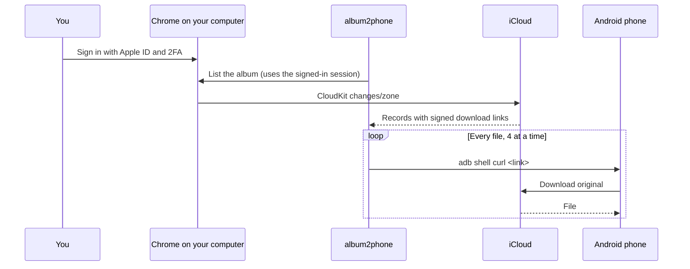

# album2phone

Download an iCloud shared album onto an Android phone in original quality, with one command.

Signing in happens once, in a Chrome window on your computer. After that the phone downloads every photo and video itself, straight from Apple, over its own connection. The computer never stores a file. It lists the album and tells the phone what to fetch over ADB.

```console
$ uv run album2phone https://photos.icloud.com/shared/album/0aBcDeFgHiJkLmNoPqRsTuV_w
Sign in to iCloud in the Chrome window. Waiting...
Summer Trip: 2400 files, 24.61 GB, 10 duplicates skipped -> /sdcard/DCIM/Summer Trip
1184/2400 files  11.42 GB / 24.61 GB  5.0 MB/s  ETA 0h 43m
```

## Why this exists

iCloud.com zips large selections on Apple's servers before you can download them. With a big album that fails with `Internal Server Error`, even at 500 items. Saving photos one at a time works, but nobody wants to do that 1,900 times on a phone.

album2phone downloads each item as its own request, like the one-by-one download that already works. It runs four at a time and resumes where it left off.

## How it works



- **Original files.** You get the same HEIC, JPEG, MOV and MP4 files the iPhone uploaded, at full resolution. These are the unedited originals, so edits made in Apple Photos are not applied.
- **Safe to stop.** A file downloads to a hidden `.name.part` file first. It gets its real name only after its size matches what iCloud reports. Run the same command again and it skips everything already complete.
- **Fresh links.** Apple's download links expire after about an hour, so the tool lists the album again every 40 minutes.
- **Correct dates.** Each file's modified time is set to when the photo was taken, so the phone's gallery sorts it in the right place.
- **Live Photos.** The motion part of a Live Photo goes to a `Live Photo clips` subfolder, so it doesn't show up as a separate video in your main folder.
- **Duplicates.** Items added to the album twice download once. Repeat uploads of the same file are skipped too, see [duplicates](#duplicates).

## Requirements

- [ ] [uv](https://docs.astral.sh/uv/)
- [ ] Google Chrome or Chromium on the computer
- [ ] [ADB](https://developer.android.com/tools/releases/platform-tools) on the computer
- [ ] An Android phone with **USB debugging** on and this computer allowed. On Xiaomi, Redmi and POCO phones, also turn on **USB debugging (Security settings)**.
- [ ] An Apple ID that can open the album link

> [!NOTE]
> The phone needs `curl`, which ships in `/system/bin` on recent Android releases. Check with `adb shell command -v curl`.

## Usage

```sh
git clone https://github.com/anxkhn/album2phone.git
cd album2phone
uv run album2phone "<shared album link>"
```

1. A Chrome window opens on the album. Sign in with your Apple ID and approve the 2FA code. Choose **Trust** when asked, so the next run skips 2FA.
2. Leave that window open. The tool picks up the session on its own and starts downloading to `/sdcard/DCIM/<album name>`.
3. Keep the phone plugged in and the computer awake until it prints `All files are on the phone.`

Run `uv run album2phone "<link>" --dry-run` first to see the file count and size without downloading anything.

### Options

| Option | Default | What it does |
| --- | --- | --- |
| `album` | required | Shared album link. `photos.icloud.com/shared/album/<id>`, `icloud.com/photos/#/sc,<id>` and a bare `<id>` all work. |
| `--serial` | the only ready device | ADB serial of the phone, from `adb devices`. Needed when more than one device is connected. |
| `--dest` | `/sdcard/DCIM/<album name>` | Folder on the phone. |
| `--workers` | `4` | Downloads running at once on the phone. |
| `--no-live` | off | Skip the video part of Live Photos. |
| `--keep-duplicates` | off | Download repeat uploads as well. |
| `--dry-run` | off | Print the file count and total size, then stop. |
| `--port` | `9333` | Chrome remote debugging port. |
| `--profile` | `~/.album2phone/chrome` | Chrome profile that keeps the iCloud sign-in. |
| `--chrome` | auto-detected | Path to Chrome or Chromium. |

### Back up with Google Photos

Google Photos only backs up the Camera folder by default. Open **Google Photos > Library**, find the album folder under **Photos on device**, and turn on **Backup**. Leave `Live Photo clips` off if you don't want the motion clips as separate videos.

> [!TIP]
> Original Pixel and Pixel XL phones back up photos and videos in Original quality for free. To use that, run the tool with the Pixel connected, so the upload happens from the Pixel.

## Duplicates

A file counts as a duplicate when it has the same file name and dimensions as one already kept, and either:

- the exact same size, which happens when someone uploads the same video twice, or
- the same capture time and a size within 0.1%, which happens when a photo is saved again with slightly different metadata.

The largest copy is kept. Burst shots and near-identical photos taken a second apart are **not** duplicates, so they all download. Pass `--keep-duplicates` to turn this off.

## Troubleshooting

<details>
<summary><code>Found 0 ready ADB devices</code> or <code>Found 2 ready ADB devices</code></summary>

Run `adb devices`. The phone must show as `device`, not `unauthorized` or `offline`. Unlock the phone and accept the USB debugging prompt. With several devices connected, pass the phone's serial with `--serial`.
</details>

<details>
<summary>It stays on <code>Waiting...</code> after I signed in</summary>

The tool waits until the Chrome tab is fully signed in to iCloud. If you see the album in Chrome and it still waits, reload the tab. If you closed the window, close Chrome and run the command again.
</details>

<details>
<summary><code>iCloud refused the album link</code></summary>

The Apple ID you signed in with can't open this album. Ask the owner to invite that Apple ID or to allow anyone with the link to join, then run again.
</details>

<details>
<summary>Some files keep failing</summary>

The tool stops when the same files fail in two rounds in a row. Check that the phone has free space and Wi-Fi, then run the same command again. Finished files are skipped.
</details>

> [!WARNING]
> The Chrome profile in `~/.album2phone/chrome` holds your iCloud session. Delete that folder when you're done, or sign out in the Chrome window.

## Development

```sh
uv run pytest
uv run ruff check . && uv run ruff format --check .
```

Everything lives in [`album2phone.py`](album2phone.py). The `plan()` function turns iCloud records into the download list and is covered by [`test_album2phone.py`](test_album2phone.py).

## Limits

- It works with the new iCloud shared albums (`photos.icloud.com/shared/album/...`). The older public `icloud.com/sharedalbum/#...` links and your personal iCloud Photos library aren't supported.
- It has been tested on macOS with Chrome. Linux and Windows should work but are untested.

## License

[MIT](LICENSE)
